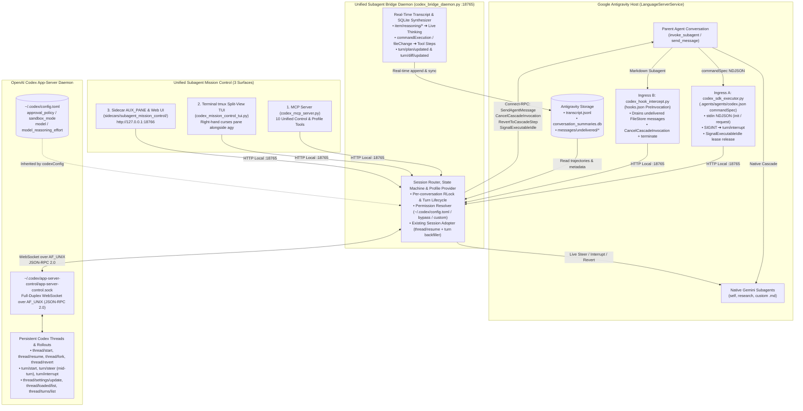
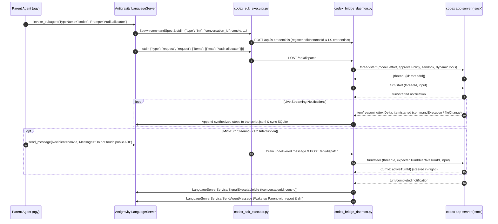
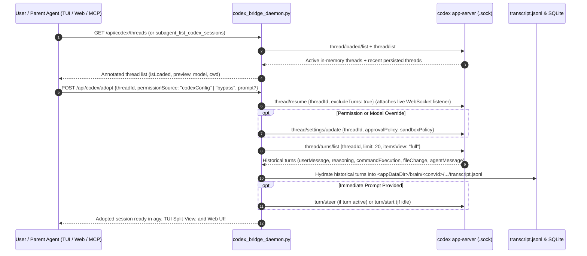

# Codex & Unified Subagent Mission Control for Google Antigravity (`agy`)

**First-class OpenAI Codex (`codex app-server` daemon) Subagent Integration + Unified Gemini & Codex Mission Control for Google Antigravity (`agy`).**

This project bridges **Google Antigravity (`agy`)** and the local **OpenAI Codex App-Server Daemon** (`~/.codex/app-server-control/app-server-control.sock`) over a persistent full-duplex **WebSocket-over-`AF_UNIX` (JSON-RPC 2.0)** connection. It allows Antigravity to spawn, adopt, inspect, mid-turn steer (`turn/steer`), interrupt, fork, revert, and hand off work across **both** OpenAI Codex subagents (`codex` and custom Codex profiles) **and** native Gemini subagents (`self`, `research`, custom `.md` agents) under a single control plane.

---

## 1. End-to-End System Architecture

Whether you use the **`sdkExecutor`** backend (`commandSpec` persistent process) or the **`preInvocation`** backend (`PreInvocation` hook), **100% of Codex execution happens over the persistent `codex app-server` Unix Domain WebSocket JSON-RPC 2.0 protocol**:



### ASCII Protocol Boundary Overview

```text
┌───────────────────────────── Left Side: Antigravity Host ─────────────────────────────┐   ┌──────────────────── Right Side: Codex App-Server Daemon ────────────────────┐
│                                                                                       │   │                                                                             │
│  Antigravity LanguageServer                                                           │   │  codex_bridge_daemon.py (:18765)     codex app-server                       │
│  (invoke_subagent / send_message)                                                     │   │  (UnifiedSubagentBridge)             (~/.codex/.../app-server-control.sock) │
│         │                                                                             │   │         │                                         │                         │
│         ├─► [Mode A: sdkExecutor]   codex_sdk_executor.py   ─┐                        │   │         │   WebSocket over AF_UNIX (JSON-RPC 2.0) │                         │
│         │   • .agents/agents/<name>.json (commandSpec)       │                        │   │         │ ◄─────────────────────────────────────► │                         │
│         │   • stdin NDJSON (init / request)                  ├─► POST /api/dispatch ─►│   │         │   • thread/start, thread/resume         │                         │
│         │   • SIGINT ──► POST /api/subagent/interrupt        │                        │   │         │   • turn/start                          │                         │
│         │   • SignalExecutableIdle on turn/completed         │                        │   │         │   • turn/steer (live mid-turn injection)│                         │
│         │                                                    │                        │   │         │   • turn/interrupt                      │                         │
│         └─► [Mode B: preInvocation] codex_hook_intercept.py ─┘                        │   │         │   • thread/fork, thread/revert          │                         │
│             • .agents/agents/<name>.md + PreInvocation hook                           │   │         │   • thread/settings/update (permissions)│                         │
│             • CancelCascadeInvocation + terminate                                     │   │         │   • thread/loaded/list, thread/list     │                         │
└───────────────────────────────────────────────────────────────────────────────────────┘   └─────────┴─────────────────────────────────────────┴─────────────────────────┘
```

---

## 2. Core Capabilities & Lifecycle Flows

### A. Dual Antigravity Ingress Modes (`sdkExecutor` vs `preInvocation`)

Both ingress adapters route every prompt and steering message to the same [`UnifiedSubagentBridge`](plugins/codex-subagent/bin/codex_bridge_daemon.py) and the same `codex app-server` WebSocket connection:

| Feature | `sdkExecutor` (`commandSpec` Native Executor) | `preInvocation` (`PreInvocation` Hook Fallback) |
| :--- | :--- | :--- |
| **Agent Definition** | `.agents/agents/<name>.json` + `~/.gemini/config/agents/<name>.json` | `.agents/agents/<name>.md` + `~/.gemini/config/agents/<name>.md` |
| **Gemini Zero-Token Guarantee** | Native `sdkExecutor` process runs directly; **Gemini LLM is never invoked** | `PreInvocation` hook calls `CancelCascadeInvocation` + `terminationBehavior: "terminate"` before Gemini LLM step |
| **Execution Lease (`BUSY` / `IDLE`)** | Held natively while `codex_sdk_executor.py` waits; released via `LanguageServerService/SignalExecutableIdle` when `turn/completed` fires | Synthesized into `conversation_summaries.db` (`CASCADE_RUN_STATUS_RUNNING` / `IDLE`) |
| **Cancellation (`SIGINT`)** | Antigravity sends `SIGINT` to `codex_sdk_executor.py`, which translates it into `turn/interrupt` on `codex app-server` without killing the persistent process | Handled via `subagent_interrupt`, `[INTERRUPT]`, TUI `[i]`, or Web UI `⏸ Interrupt` |
| **Default On** | Local workspace (`./install.sh --mode=sdkExecutor`) | Repository default (`./install.sh --mode=preInvocation`) for broad version compatibility |



---

### B. Directly Taking Over Existing Standalone Codex Sessions (`thread/adopt`)

Already have a `codex` TUI or VS Code session running (or saved on disk) in `codex app-server`? You can take it over directly inside Antigravity without restarting it:



---

### C. Flexible Permission Control: `~/.codex/config.toml` Inheritance & One-Click Bypass

Codex permissions can be controlled at **global config level**, **per-profile level**, **on session takeover**, or **live mid-session** via `thread/settings/update`:

1. **`permissionSource: "codexConfig"` (Default)**:
   - Automatically parses [`~/.codex/config.toml`](file:///home/zhdi/.codex/config.toml) (`approval_policy` and `sandbox_mode`, plus default `model` and `model_reasoning_effort`).
   - If your `~/.codex/config.toml` has `approval_policy = "never"` and `sandbox_mode = "danger-full-access"`, every Codex subagent automatically inherits full autonomous permissions.
2. **`permissionSource: "bypass"` (One-Click Full Bypass)**:
   - Forces `approvalPolicy = "never"` and `sandboxPolicy = {"type": "dangerFullAccess"}` regardless of config files.
   - Switchable anytime mid-session via TUI hotkey **`P`** (`Shift+P` -> `bypass`), Web UI button **`⚡ One-Click Bypass Permissions`**, MCP `subagent_configure(conversationId=..., permissionSource="bypass")`, or `send_message(..., Message="[PERMISSION:bypass]")`.
3. **`permissionSource: "custom"` (Granular Sandbox & Approval Policy)**:
   - Mix and match `approvalPolicy` (`never` | `on-request` | `untrusted` | `inherit`) and `sandboxMode` (`danger-full-access` | `workspace-write` | `read-only` | `inherit`).

---

### D. Custom Codex Subagent Profile Provider (`subagent_define_profile`)

The plugin acts as a dynamic **Subagent Profile Provider** for Antigravity. You can define specialized Codex subagent types (e.g. `codex-reviewer`, `codex-rust-auditor`, `codex-security`) with dedicated models, reasoning efforts, system instructions, and permission policies:

```json
{
  "name": "codex-reviewer",
  "description": "Strict architecture and concurrency reviewer",
  "model": "gpt-6.2-sol",
  "effort": "xhigh",
  "permissionSource": "codexConfig",
  "sandboxMode": "read-only",
  "approvalPolicy": "never",
  "executionMode": "sdkExecutor",
  "systemPrompt": "Audit all changes for lock ordering, race conditions, and state-machine invariants."
}
```

When defined via MCP (`subagent_define_profile`), TUI (`[p]`), or Web UI (`Handoff & Config` tab), the bridge atomically generates the corresponding Antigravity agent definitions in `.agents/agents/<name>.*` and `~/.gemini/config/agents/<name>.*` so `invoke_subagent(TypeName="codex-reviewer", ...)` works natively.

---

## 3. Repository Layout & Component Reference

| Path | Role |
| :--- | :--- |
| [`install.sh`](install.sh) | Root installer (`./install.sh --mode=sdkExecutor` or `--mode=preInvocation`) |
| [`plugins/codex-subagent/plugin.json`](plugins/codex-subagent/plugin.json) | Antigravity plugin manifest (`skills`, `agents`, `rules`, `hooks`, `mcpServers`, `sidecars`) |
| [`plugins/codex-subagent/config.example.json`](plugins/codex-subagent/config.example.json) | Default configuration template (`preInvocation`, `gpt-6.2-sol`, `xhigh`, `permissionSource: "codexConfig"`) |
| [`plugins/codex-subagent/bin/codex_ws_client.py`](plugins/codex-subagent/bin/codex_ws_client.py) | Zero-dependency RFC 6455 WebSocket-over-`AF_UNIX` client for `~/.codex/app-server-control/app-server-control.sock` |
| [`plugins/codex-subagent/bin/codex_bridge_daemon.py`](plugins/codex-subagent/bin/codex_bridge_daemon.py) | Unified Subagent Bridge Daemon (`127.0.0.1:18765`) managing both Codex and native Gemini subagents |
| [`plugins/codex-subagent/bin/codex_sdk_executor.py`](plugins/codex-subagent/bin/codex_sdk_executor.py) | Native Antigravity `commandSpec` persistent NDJSON executor (`init`, `request`, `SIGINT`, `SignalExecutableIdle`) |
| [`plugins/codex-subagent/bin/codex_hook_intercept.py`](plugins/codex-subagent/bin/codex_hook_intercept.py) | `PreInvocation` hook interceptor for Markdown subagent definitions |
| [`plugins/codex-subagent/bin/codex_profiles.py`](plugins/codex-subagent/bin/codex_profiles.py) | Profile provider, `~/.codex/config.toml` parser, permission resolver, and atomic definition installer |
| [`plugins/codex-subagent/bin/codex_mcp_server.py`](plugins/codex-subagent/bin/codex_mcp_server.py) | Stdio JSON-RPC 2.0 MCP server (`codex-subagent-control`) exposing 12 unified control tools |
| [`plugins/codex-subagent/bin/codex_mission_control_tui.py`](plugins/codex-subagent/bin/codex_mission_control_tui.py) | Right-hand `tmux` split-view terminal UI (`curses`) |
| [`plugins/codex-subagent/sidecars/subagent_mission_control/`](plugins/codex-subagent/sidecars/subagent_mission_control/) | Antigravity 2.0 `AUX_PANE` Sidecar & standalone Web UI (`http://127.0.0.1:18766`) |
| [`ARCHITECTURE_REVIEW.md`](ARCHITECTURE_REVIEW.md) | Deep state-machine & race-condition audit authored by `gpt-6.2-sol` |
| [`tests/test_e2e_all_phases.py`](tests/test_e2e_all_phases.py) | 16 deterministic + live end-to-end verification tests across all phases |

---

## 4. Installation & Mode Switching

```bash
git clone git@github.com:ZHDI-1/agy-codex-subagent.git
cd agy-codex-subagent

# Option A: Install with preInvocation hook (repository default for broad compatibility)
./install.sh

# Option B: Install with native persistent sdkExecutor (recommended when commandSpec is supported)
./install.sh --mode=sdkExecutor
```

---

## 5. Control Plane Reference

### A. Unified MCP Tools (`codex-subagent-control`)

| MCP Tool | Target Engine | Description |
| :--- | :--- | :--- |
| `subagent_list` | **Codex + Gemini** | Lists all active & recent subagents with live status, step count, activity, permissions, and `threadId` |
| `subagent_inspect` | **Codex + Gemini** | Non-blocking live inspection of thinking stream, tool steps, `turn/plan/updated` checklist, and unified file diff |
| `subagent_steer` | **Codex + Gemini** | Mid-turn steer (`mode: "steer" \| "queue" \| "interrupt_and_steer"`) via `turn/steer` (Codex) or `SendAgentMessage` (Gemini) |
| `subagent_interrupt` | **Codex + Gemini** | Cleanly pauses active turn via `turn/interrupt` (Codex) or `CancelCascadeInvocation` (Gemini) |
| `subagent_revert` | **Codex + Gemini** | Drops last `N` turns via `thread/revert` (Codex) or rewinds trajectory via `RevertToCascadeStep` (Gemini) |
| `subagent_fork` | **Codex + Gemini** | Forks a Codex thread via `thread/fork` (optionally at `beforeTurnId`) or forks Gemini context into a new Codex thread |
| `subagent_configure` | **Codex** | Live updates `model`, `effort`, `permissionSource` (`codexConfig` / `bypass` / `custom`), `approvalPolicy`, `sandboxMode`, or triggers `compact` |
| `subagent_handoff` | **Codex ⇄ Gemini** | Transfers latest thinking, findings, and workspace directory from `research`/`self` to `codex` (or vice versa) |
| `subagent_list_codex_sessions` | **Codex** | Lists loaded in-memory threads (`thread/loaded/list`) and persisted sessions (`thread/list`) from `codex app-server` |
| `subagent_adopt_codex_session` | **Codex** | Directly takes over an existing Codex `threadId`, imports its historical turns into `transcript.jsonl`, and applies permissions |
| `subagent_define_profile` | **Codex** | Creates or updates a specialized Codex subagent profile and registers its native Antigravity subagent definition |
| `subagent_list_profiles` | **Codex** | Lists all saved Codex profiles, default config, and parsed `~/.codex/config.toml` settings |

---

### B. `send_message` Inline Control Directives

When messaging a Codex subagent via `send_message(Recipient=<conversationId>, Message=...)`:

| Directive | Underlying `codex app-server` RPC | Behavior |
| :--- | :--- | :--- |
| `<plain text>` | `turn/steer` (if active) or `turn/start` (if idle) | Automatically steers the active turn mid-flight or starts a follow-up turn on the same `threadId` |
| `[STEER] <instruction>` | `turn/steer` | Explicitly injects mid-turn guidance into the active turn |
| `[QUEUE] <instruction>` | `thread/queue/add` | Queues prompt for the next turn without interrupting current work |
| `[INTERRUPT]` / `[INTERRUPT] <new_task>` | `turn/interrupt` (+ `turn/start`) | Aborts the active turn and optionally starts `<new_task>` |
| `[REVERT:N]` | `thread/revert` | Drops and reverts the last `N` turns on the Codex thread |
| `[EFFORT:low\|medium\|high\|xhigh\|ultra]` | `turn/settings/update` & `thread/settings/update` | Dynamically changes reasoning effort |
| `[MODEL:<model>]` | `turn/settings/update` & `thread/settings/update` | Dynamically switches the Codex model |
| `[PERMISSION:bypass\|codexConfig\|<ap>:<sb>]` | `thread/settings/update` | Dynamically switches permissions (`bypass`, `~/.codex/config.toml`, or custom `never:danger-full-access`) |
| `[ADOPT:<threadId>] <optional prompt>` | `thread/resume` + `thread/turns/list` | Takes over an existing standalone Codex session and hydrates its history |
| `[COMPACT]` | `thread/compact/start` | Triggers context window compaction on the Codex thread |

---

### C. Right-Hand `tmux` Split-View TUI (`codex_mission_control_tui.py`)

```bash
python3 plugins/codex-subagent/bin/codex_mission_control_tui.py --split --all
```

| Hotkey | Action |
| :--- | :--- |
| `↑` / `↓` | Select subagent (`[CODEX]` or `[GEMINI]`) |
| `1` / `2` / `3` | Switch inspector tab (`1:Stream & Steps`, `2:Live Diff`, `3:Plan & Events`) |
| `j` / `k` / `PgUp` / `PgDn` | Scroll inspector viewport |
| `a` | Toggle scope (`Current Session` vs `All History`) |
| `f` | Cycle engine filter (`ALL` ➔ `CODEX` ➔ `GEMINI`) |
| `s` | **Mid-Turn Steer** (`turn/steer` for Codex, `SendAgentMessage` for Gemini) |
| `q` | **Queue Next Turn** (`thread/queue/add`) |
| `i` | **Interrupt Active Turn** (`turn/interrupt` / `CancelCascadeInvocation`) |
| `t` | **Take Over Existing Codex Session** (lists loaded/recent daemon threads for instant takeover) |
| `P` (`Shift+P`) | **Live Permission Switch** (`bypass` / `codexConfig` / custom `approval:sandbox`) |
| `F` (`Shift+F`) | **Fork Thread** (`thread/fork`) |
| `r` | **Revert Last N Turns / Steps** (`thread/revert` / `RevertToCascadeStep`) |
| `m` | **Change Reasoning Effort** (`low` / `medium` / `high` / `xhigh` / `ultra`) |
| `p` | **Manage Codex Subagent Profiles** (create / update custom subagent types) |
| `h` | **Cross-Engine Handoff** (hand off findings & workspace to Codex) |
| `Q` / `Esc` | Close split view |

---

### D. Sidecar Auxiliary Pane & Standalone Web UI (`:18766`)

```bash
ANTIGRAVITY_SIDECAR_WEB_PORT=18766 node plugins/codex-subagent/sidecars/subagent_mission_control/main.mjs
```

Open **`http://127.0.0.1:18766`** in your browser (or click **Subagent Mission Control** in the Antigravity 2.0 Desktop Auxiliary Pane) for:
- **Unified Roster & Live Stream Inspector** (live reasoning, tool chips, per-step `Revert here` buttons)
- **📥 Take Over Session Modal** (one-click takeover of any `🟢 [LOADED]` or `⚪ [DISK]` Codex session)
- **⚡ One-Click Bypass Permissions** & `~/.codex/config.toml` inheritance selector
- **Live Syntax-Highlighted Unified Diff Viewer** & **`turn/plan/updated` Execution Checklist**
- **Subagent Profile Provider Manager** & **Cross-Engine Handoff (`Gemini ⇄ Codex`)**

---

## 6. Verification & E2E Test Suite

```bash
agy plugin validate ./plugins/codex-subagent
python3 ./tests/test_e2e_all_phases.py
```
